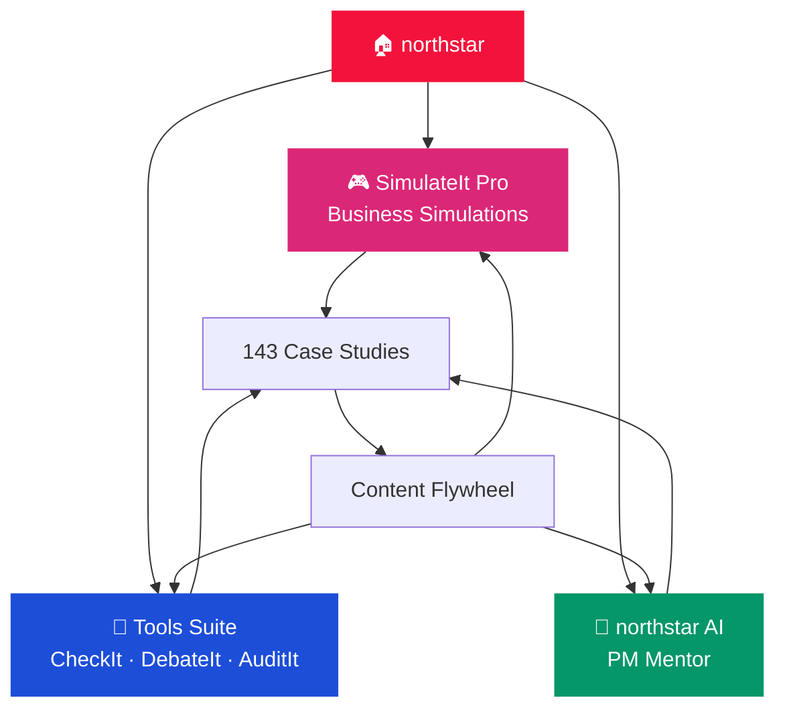
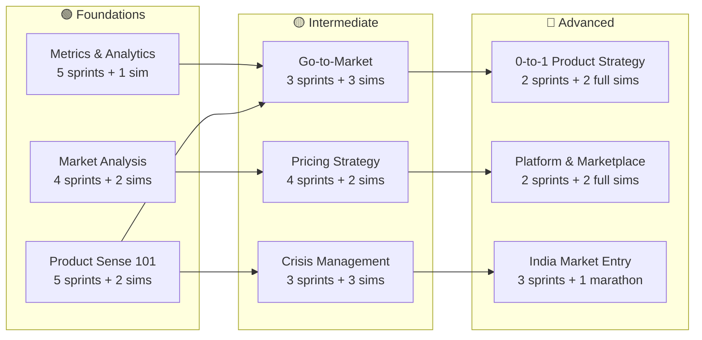
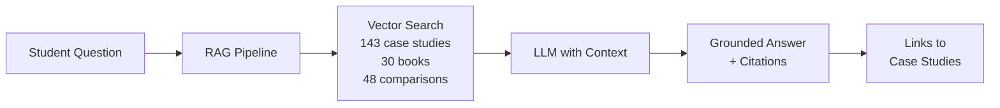
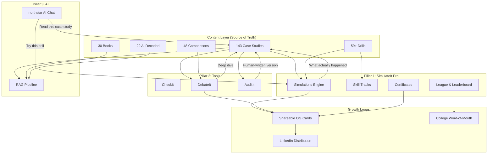

# northstar → The PM Simulation Platform
## Product Vision & Architecture — August 2026

---

> **The pitch:** *"Every MBA student in India practices case competitions on northstar before the real thing."*
>
> Today northstar is a content library. Tomorrow it's the **practice arena** — where MBA students build product intuition through real-company simulations, sharpen skills with AI-powered tools, and walk into case competitions and PM interviews already battle-tested.

---

## The Three Pillars



**The moat:** Every pillar is powered by 143 real-company case studies. No competitor has this corpus. Unstop runs fictional cases. RocketBlocks teaches frameworks. GoPractice simulates fake dashboards. **northstar simulates real decisions that real founders actually made — and shows you what happened.**

---

## Pillar 1: SimulateIt Pro — The Business Simulation Engine

### What Exists Today
- 59 branching decision drills across 6 categories (product, strategy, crisis, scope, founder, strategic)
- 4-dimension scoring (Product, Business, Founder, Strategy) with per-option points + rationales
- League infrastructure (leaderboard, referrals, matchday scheduling) — partially built
- Builder Draft (personality quiz → archetype card) — built
- Shareable OG score cards (🟩🟨🟥 grid)
- Weekly streaks, attempt history, dimensional accuracy tracking

### What MBA Students Need (The Gap)

| Feature | Current State | Target State |
|---------|--------------|--------------|
| **Simulation depth** | 5-7 decision nodes, 5-12 min | **Sprint (5 min)** + **Full Sim (20-30 min, 10-15 nodes)** + **Marathon (45-60 min, multi-round)** |
| **Difficulty levels** | Implicit only | **Beginner → Intermediate → Advanced → Elite** (frontmatter `difficulty` field) |
| **Structured learning** | Flat list of drills | **Skill Tracks** with prerequisites and progression |
| **Practice vs Competition** | Single mode | **Practice Mode** (hints, undo, explanations) vs **Competition Mode** (timed, no undo, proctored) |
| **Proctoring** | None | **Tab-switch detection, fullscreen enforcement, timer lockout** |
| **Data-driven decisions** | Text-only prompts | **Embedded charts, metrics tables, mock dashboards** in decision nodes |
| **Certificates** | None | **Verifiable completion certificates** per track |
| **Cohort benchmarking** | Global leaderboard only | **College-level, batch-level, percentile benchmarking** |
| **Competency analysis** | 4-dimension bar chart | **Radar chart + trend lines + strength/weakness analysis** |

---

### New Simulation Formats

#### 1. Sprint Drills (3-5 min) — *"PM Warm-ups"*
Quick-fire single-skill exercises. One scenario, one decision, instant feedback.
- **Metric Drop:** "DAU dropped 14% after v2.4 — root-cause it from these 4 options"
- **Prioritization:** "You have these 4 features and this RICE data — rank them"
- **Estimation:** "How many UPI transactions happen in India per day? Build your logic"
- **Stakeholder:** "Your CEO wants to pivot. Your data says no. Pick your response"

> [!TIP]
> Sprint drills are the **daily habit** hook (like Brilliant's 15-min lessons). Low friction → high frequency → streak retention.

#### 2. Full Simulations (15-25 min) — *"Case Comp Practice"*
Multi-stage branching scenarios grounded in real case studies. This is the **core product** for MBA students.

**Example: "The Zomato Dilemma" (based on your Zomato case study)**
```
Round 1: Market Entry (2015)
  → You're a food-tech PM in India. UberEats just entered. 
  → Here's your DAU data, burn rate, and city-wise unit economics [embedded chart].
  → Decision: Double down on top 8 cities or expand to 20?

Round 2: Pivot Pressure (2020)
  → COVID hits. Dine-in revenue: zero. Here's your cash runway [data table].
  → Decision: Launch grocery delivery, pivot to cloud kitchens, or wait it out?

Round 3: The Blinkit Bet (2022)
  → Quick commerce is exploding. Blinkit is available for acquisition.
  → Here's Blinkit's metrics vs. building in-house estimates [comparison chart].
  → Decision: Acquire Blinkit, build your own, or partner?

Round 4: IPO Readiness (2023)
  → Public markets are scrutinizing profitability. Here's your P&L.
  → Decision: Cut ESOP burns, raise prices, or reduce city coverage?
```

Each round: real data (simplified), real constraints, real outcome. After completion: "Here's what Zomato actually did and why" — linking to the full case study.

#### 3. Marathon Simulations (45-60 min) — *"The Full Case Competition"*
Multi-round, multi-stakeholder simulations that mirror actual case comp formats:
- Round 1: Market analysis + strategy formulation (15 min, timed)
- Round 2: Stakeholder negotiation (AI-powered pushback)  
- Round 3: Crisis management (real-time data changes mid-decision)
- Round 4: Board presentation (structured output format)

> [!IMPORTANT]
> Marathon sims are the **differentiation**. This is what students can't practice anywhere else. Unstop runs the competitions — northstar is where you practice for them.

---

### Skill Tracks (Structured Learning Paths)



Each track has:
- **Prerequisites** (must complete Foundations before Intermediate)
- **Completion %** progress bar
- **Track Certificate** on completion (shareable, verifiable)
- **Cohort percentile** (how you rank vs. others who completed this track)

---

### Practice Mode vs Competition Mode

| Aspect | 🟢 Practice Mode | 🔴 Competition Mode |
|--------|-----------------|-------------------|
| **Timer** | No time limit | Strict countdown (configurable: 15/30/45 min) |
| **Hints** | Available (shows pattern tag + related case study) | Disabled |
| **Undo** | Can go back one decision | No going back |
| **Rationale reveal** | After each decision | Only after completion |
| **Data overlays** | Highlighted key metrics | Raw data, figure it out |
| **Scoring** | Shows running score | Hidden until end |
| **Proctoring** | None | Tab-switch detection, fullscreen, timer pause on exit |
| **League points** | None | Earned on first attempt |
| **Certificate eligible** | No | Yes (if score ≥ 70%) |

### Proctoring (Competition Mode)
Not webcam-level (that's overkill for a free platform). **Lightweight integrity signals:**
- ⚡ **Fullscreen enforcement** — exits fullscreen → timer pauses, warning issued
- 🚫 **Tab-switch detection** — `visibilitychange` API → logged as flag, 3 switches = integrity warning on score card
- ⏱️ **Time-per-decision tracking** — unusually fast = flagged (likely looked up answer)
- 🔒 **Copy-paste disabled** on prompts (prevent pasting into ChatGPT)
- 📊 **Integrity score** shown alongside simulation score (e.g., "Score: 82/100 · Integrity: ✅ Clean")

---

### Competency System & Certificates

#### Radar Chart (replaces simple bar chart)
```
         Product Sense
              ▲
             /|\
            / | \
           /  |  \
  Strategy ───┼─── Business
           \  |  /
            \ | /
             \|/
              ▼
        Founder Instinct
```
- Built from cumulative drill performance across all attempts
- Overlaid with **cohort average** (how the average MBA student performs)
- Trend arrows (↑↓→) showing improvement over time
- Exportable as image for LinkedIn / resume

#### Certificates
- **Track Completion Certificate** — "Completed 0-to-1 Product Strategy track with 78% accuracy"
- **Simulation Band Certificate** — "Achieved 'Launch-Ready' band across 10 simulations"
- **League Season Certificate** — "Ranked #42 of 1,200 in Season 1"
- Verifiable via unique URL (`pmnorthstar.in/verify/[code]`)
- Shareable OG card (like current SimulateIt score cards but formal)

---

## Pillar 2: Tools Suite

### Existing: CheckIt (`/checkit`)
35-check site readiness audit → score /100 → band → fixes. **Keep as-is**, it's working.

### New: DebateIt (`/debate`)
**AI-powered product debate arena for MBA students.**

- Pick a product dilemma (seeded from your case studies):
  - *"Should Spotify have launched video?"*
  - *"Was Zomato right to acquire Blinkit?"*
  - *"Should Paytm have stuck to wallets?"*
- Take a side. Argue in 3 rounds against an AI opponent.
- AI uses your case study content as its knowledge base (no hallucination — grounded responses).
- Scored on: **Argument structure** · **Evidence usage** · **Counter-argument handling** · **Strategic thinking**
- Shareable: "I won a debate about Zomato's Blinkit acquisition — 87/100"

**Why it matters for MBA students:**
- Case competitions require defending positions under pressure
- Group discussions in placements test exactly this skill
- No platform offers structured debate practice with AI feedback

### New: AuditIt (`/audit`)
**Instant AI product teardown generator.**

- Enter any product name → get a structured teardown:
  - Positioning & target audience
  - Revenue model analysis
  - Growth loop identification
  - Competitive moat assessment
  - "What I'd change" recommendations
- Styled like your case studies but AI-generated
- Links to related hand-written case studies: *"Want the full human deep-dive? Read our Razorpay case study"*

**Why it matters for MBA students:**
- Case comps often require rapid product analysis of unfamiliar companies
- Practice tool: analyze 5 products before the competition to build muscle memory

---

## Pillar 3: northstar AI — The PM Mentor

### What It Is
A conversational AI grounded in northstar's **entire corpus**: 143 case studies, 30 books, 48 comparisons, 29 AI Decoded, 14 topics.

### How It Works


### Use Cases
1. **"How did Notion grow without paid ads?"**
   → Answer grounded in your Notion case study, cites specific growth loops, links to full article.

2. **"Compare Stripe vs Razorpay's go-to-market strategy"**
   → Pulls from your comparison + both case studies, gives structured comparison.

3. **"I'm building a B2B SaaS in India. What pricing model should I use?"**
   → Synthesizes learnings from relevant Indian case studies + pricing-focused content.

4. **"Prepare me for a case comp on food delivery in India"**
   → Pulls Zomato, Swiggy case studies + relevant drills + comparison content.

5. **"What are the key mental models for a 0-to-1 PM?"**
   → Synthesizes from books + case studies + drill pattern tags.

### Why It's Defensible
- Generic ChatGPT gives generic answers. northstar AI gives answers grounded in **curated, expert-written, real-company analysis.**
- Every answer drives content consumption (citations link to articles).
- The corpus grows (143 → 200 → 300 case studies), making the AI smarter over time.

---

## Architecture: How the Three Pillars Connect



> [!IMPORTANT]
> **The flywheel:** Content → powers simulations, debates, AI answers → students share scores on LinkedIn → new students discover northstar → they consume content → they do simulations → they share scores. Every pillar feeds the others.

---

## Data Model Extensions

New Prisma models needed:

```prisma
// ─── Skill Tracks & Curriculum ───
model SkillTrack {
  id          String   @id @default(uuid())
  slug        String   @unique
  name        String                     // "0-to-1 Product Strategy"
  tier        String                     // "foundations" | "intermediate" | "advanced"
  drillSlugs  Json                       // ordered array of drill slugs
  prerequisiteSlugs Json   @default("[]") // track slugs required before starting
  createdAt   DateTime @default(now())
}

model TrackProgress {
  id          String   @id @default(uuid())
  userId      String   @map("user_id")
  trackSlug   String   @map("track_slug")
  completedDrills Json @default("[]")    // array of completed drill slugs
  startedAt   DateTime @default(now())
  completedAt DateTime?
  certificateCode String? @unique        // verifiable cert URL code
  user        User     @relation(fields: [userId], references: [id], onDelete: Cascade)
  
  @@unique([userId, trackSlug])
}

// ─── Competition Mode & Proctoring ───
model CompetitionAttempt {
  id              String   @id @default(uuid())
  userId          String   @map("user_id")
  drillSlug       String   @map("drill_slug")
  score           Int
  maxPossible     Int      @map("max_possible")
  timeTakenSec    Int      @map("time_taken_sec")
  tabSwitches     Int      @default(0) @map("tab_switches")
  fullscreenExits Int      @default(0) @map("fullscreen_exits")
  integrityClean  Boolean  @default(true) @map("integrity_clean")
  pathTaken       Json     @map("path_taken")
  attemptedAt     DateTime @default(now())
  user            User     @relation(fields: [userId], references: [id], onDelete: Cascade)
}

// ─── DebateIt ───
model DebateAttempt {
  id          String   @id @default(uuid())
  userId      String   @map("user_id")
  topicSlug   String   @map("topic_slug")
  side        String                     // "for" | "against"
  rounds      Json                       // [{ userArg, aiArg, roundScore }]
  totalScore  Int      @map("total_score")
  attemptedAt DateTime @default(now())
  user        User     @relation(fields: [userId], references: [id], onDelete: Cascade)
}

// ─── Certificates ───
model Certificate {
  id          String   @id @default(uuid())
  userId      String   @map("user_id")
  type        String                     // "track" | "league" | "simulation"
  title       String                     // "Completed: 0-to-1 Product Strategy"
  code        String   @unique           // verifiable URL code
  metadata    Json                       // { trackSlug?, score?, rank?, season? }
  issuedAt    DateTime @default(now())
  user        User     @relation(fields: [userId], references: [id], onDelete: Cascade)
}
```

### Drill Frontmatter Extensions
```yaml
# New fields for existing content/drills/*.md
difficulty: intermediate          # beginner | intermediate | advanced | elite
estimatedMinutes: 25              # already exists, but standardize
format: full                      # sprint | full | marathon
track: zero-to-one               # which skill track this belongs to
dataAssets:                       # embedded data for data-driven decisions
  - type: chart
    title: "Monthly Active Users"
    data: [{ month: "Jan", value: 120000 }, ...]
  - type: table
    title: "Unit Economics by City"
    columns: ["City", "AOV", "CAC", "LTV"]
    rows: [["Mumbai", "₹350", "₹120", "₹890"], ...]
competitionTimeLimitSec: 900      # 15 min time limit for competition mode
```

---

## Phased Roadmap

### Phase 1: Foundation (3-4 weeks)
> *Ship the infrastructure that makes everything else possible.*

- [ ] **Add `difficulty` field** to all 59 drill frontmatter files + sync script
- [ ] **Build Skill Tracks** — define 4-6 tracks, group existing drills, add `SkillTrack` + `TrackProgress` models
- [ ] **Skill Tracks UI** — `/simulate/tracks` page with progression tree, completion %, prerequisite gating
- [ ] **Competition Mode toggle** — timer, no-undo, hidden score, tab-switch/fullscreen detection
- [ ] **Competency Radar Chart** — replace dimensional bar charts with interactive radar (overlay cohort avg)
- [ ] **Sprint Drill format** — author 10 sprint drills (3-5 min, single-decision), add `format: sprint` field
- [ ] **Builder Draft launch** — finish and ship (quiz → archetype card → shareable OG)
- [ ] **League Season 1 launch** — activate existing infrastructure, define season rules

### Phase 2: Intelligence (4-6 weeks)
> *Add AI and make northstar think.*

- [ ] **northstar AI v1** — RAG pipeline over case studies + books, chat UI at `/ai`, citation links
- [ ] **DebateIt v1** — 20 debate topics seeded from case studies, AI opponent using your content as knowledge base, 3-round format, scoring rubric, shareable OG card
- [ ] **Data-driven decisions** — add `dataAssets` support to drill format, render charts/tables in SimulatePlayer
- [ ] **Full Simulation format** — author 5 multi-round sims (15-25 min, 10-15 nodes, embedded data)
- [ ] **AI Coaching hints** — in Practice Mode, LLM generates contextual hints based on the scenario + related case study
- [ ] **Certificate system** — `Certificate` model, `/verify/[code]` page, shareable OG card

### Phase 3: Institution (6-8 weeks)
> *Make it the platform B-schools adopt.*

- [ ] **AuditIt v1** — AI product teardown generator, structured output, links to case studies
- [ ] **Marathon Simulation format** — 45-60 min multi-round sims with mid-simulation data changes
- [ ] **College Benchmarking** — optional college tag on profile, college-level leaderboards and percentile
- [ ] **Track Certificates with OG cards** — formal, shareable, verifiable
- [ ] **Cohort percentile system** — "You scored better than 73% of MBA students"
- [ ] **B-school outreach** — landing page for placement cells / faculty, bulk invite system
- [ ] **PM Portfolio integration** — export your simulation history + competency radar as a portfolio page

---

## Go-to-Market: Reaching MBA Students

### Distribution Channels (in priority order)

1. **LinkedIn (existing)** — shift posting mix: 40% case studies, 30% simulation results/challenges, 20% debate highlights, 10% AI insights. Every post includes a challenge: *"Can you beat 82% on the Zomato simulation?"*

2. **College WhatsApp/Telegram groups** — MBA students live here. Shareable score cards are designed for this. One student shares → entire batch tries it.

3. **B-school case competition partnerships** — approach Unstop-hosted competitions: *"Practice for [Competition Name] on northstar"*. Create competition-specific practice tracks.

4. **Placement cell outreach** — pitch to IIM/ISB/XLRI placement cells: *"Your students can practice PM case rounds on northstar for free."* Certificates add to CVs.

5. **MBA prep communities** — PagalGuy, MBA Crystal Ball, InsideIIM forums. northstar AI answering PM questions → drives discovery.

6. **Substack newsletter** — shift from pure content digest to *"This week's simulation challenge + leaderboard update + AI insight"*

### The Viral Loop
```
Student discovers northstar (LinkedIn/WhatsApp)
  → Plays a simulation
    → Gets a score card (🟩🟨🟥)
      → Shares on LinkedIn/WhatsApp ("Beat my score!")
        → Friends discover northstar
          → They play
            → They share
              → 🔄 Loop
```

> [!NOTE]
> This is the **exact same loop** that made Wordle viral. Score cards + social challenge + low friction = exponential word-of-mouth in tight-knit MBA cohorts.

---

## Competitive Positioning

| | **northstar** | **Unstop** | **RocketBlocks** | **GoPractice** |
|---|---|---|---|---|
| **Content** | 143 real-company case studies | Fictional corporate cases | Framework drills | Simulated dashboards |
| **Simulations** | Branching decisions on real stories | Multi-round competitions | Quick skill drills | Analytics roleplay |
| **AI** | Mentor grounded in real cases | None | None | None |
| **Tools** | CheckIt + DebateIt + AuditIt | Assessment engine | None | None |
| **Target** | MBA students & PMs | All college students | PM interview candidates | Working PMs |
| **Price** | Free | Free/Paid competitions | $149-299/mo | $99-249/course |
| **Moat** | Real case study corpus | Corporate partnerships | Interview framework IP | Simulation engine |

**northstar's wedge:** Free, grounded in reality, India-first, built for practice not competition. *Unstop is the exam hall. northstar is the study room.*

---

*Ready to build? The foundation phase can start today — difficulty tagging the 59 drills, defining skill tracks, and wiring up Competition Mode are all buildable on the existing architecture.*
