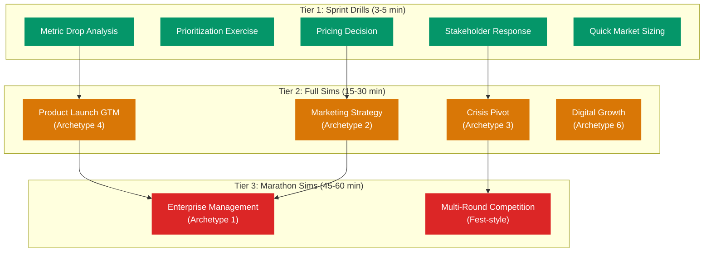

# MBA Business Simulation Intelligence Report
## What Students Actually Face — and How northstar Mirrors It

*Compiled August 10, 2026*

---

## TL;DR

MBA students face **6 types of business simulations** across competitions (Unstop, B-school fests) and coursework (Capsim, Markstrat). They all share a core loop:

```
Receive data → Analyze under time pressure → Make multi-lever decisions → See consequences → Repeat
```

**northstar's opportunity:** Nobody offers a free practice ground for these. Capsim costs $60/student. Markstrat costs $100+. Unstop competitions are one-shot — fail and you're out. northstar can be the place where students practice the *exact same decision types* using *real company data* for free.

---

## The 6 Simulation Archetypes

Every simulation an MBA student encounters falls into one of these:

| # | Archetype | Real-World Platform | Decisions | Time | northstar Version |
|---|-----------|-------------------|-----------|------|-------------------|
| 1 | **Enterprise Management** | Capsim, Cesim SimFirm | R&D + Marketing + Ops + Finance (all at once) | 5-8 rounds, 1-2 hrs/round | **Marathon Sim** (45-60 min) |
| 2 | **Marketing Strategy** | Markstrat, Cesim SimBrand | Product positioning, pricing, ad spend, distribution | 8-10 rounds, hours/round | **Full Sim** (20-30 min) |
| 3 | **Crisis / Pivot** | HBP scenarios, B-school fests | React to shocks mid-game, reallocate resources | 1-2 hrs total, shocks injected | **Full Sim** with mid-sim data changes |
| 4 | **Product Launch / GTM** | HBP, Marketplace | Design product, price it, pick channels, launch | 90-120 min single session | **Full Sim** (15-25 min) |
| 5 | **Operations / Supply Chain** | Beer Game, Cesim | Inventory, capacity, logistics, cost optimization | 4-6 rounds, 20 min/round | **Full Sim** with data tables |
| 6 | **Digital Marketing** | Stukent MIMIC | Ad spend, keywords, content, conversion optimization | 10-14 rounds, analysis between | **Sprint Drills** (quick decisions + data) |

---

## Deep Mechanics: What Exactly Do Students Face?

### 🏢 Archetype 1: Enterprise Management (Capsim-style)

> *"Manage an entire company. Every decision affects every other decision. Don't go bankrupt."*

**The Setup:**
- You run a sensor manufacturing company competing against 4-5 other teams
- Market has 5 segments (Low Tech, High Tech, Performance, Size, Traditional) each with different buying criteria
- You start with 5 existing products positioned across segments

**Decisions Per Round (all made simultaneously):**

| Department | Decisions | Data You're Given |
|------------|-----------|-------------------|
| **R&D** | Product specs (performance, size, reliability/MTBF), new product development, product retirement | Perceptual map showing ideal spot per segment, customer buying criteria weights |
| **Marketing** | Price per product, promotion budget (drives awareness), sales budget (drives accessibility), demand forecast | Segment growth rates, competitor prices, current awareness/accessibility % |
| **Production** | Units to produce, buy/sell capacity, automation level per product line | Inventory levels, capacity utilization, labor costs, 2nd shift availability |
| **Finance** | Issue/retire stock, issue/retire long-term bonds, short-term borrowing, dividend policy | Proforma income statement, balance sheet, cash flow projections |
| **HR** *(advanced)* | Recruiting spend, training hours, annual raise % | Employee productivity, turnover rate, overtime costs |
| **TQM** *(advanced)* | Quality initiative investments (CPI, benchmarking, training) | Defect rates, cycle time, material/admin cost reduction |

**The Time Crunch:**
- 8 rounds (years), each taking **1-2 hours** of team deliberation
- In competition settings, compressed to **30-45 minutes per round**
- Teams physically divide into "C-suite roles" (CEO, CFO, CMO, COO) to parallelize analysis

**Scoring (Balanced Scorecard):**
| Category | Weight | Metrics |
|----------|--------|---------|
| Financial | 25% | Stock price, profit, ROE, ROA |
| Customer | 25% | Market share, product count, SGA-to-revenue ratio |
| Internal Process | 25% | Contribution margins, plant utilization, days of inventory |
| Learning & Growth | 25% | Employee productivity, asset turnover, revenue per employee |

**Common Fatal Mistakes:**
1. ☠️ **Emergency loans** — running out of cash from over-producing (excess inventory) → forced high-interest bailout
2. ☠️ **Ignoring the perceptual map** — products drift outside customer "ideal spots" → market share collapse
3. ☠️ **Siloed decisions** — R&D designs a product but Finance didn't fund the capacity to produce it
4. ☠️ **Over-automating** — high automation = can't pivot product specs quickly when market shifts

> [!IMPORTANT]
> **This is the hardest archetype to replicate** in a web-based sim. Capsim works because all teams' decisions are processed simultaneously in a competitive market. But northstar can simulate the *decision-making process* — give students the same data, the same trade-offs, and score their choices against what optimal decisions would have been.

---

### 📊 Archetype 2: Marketing Strategy (Markstrat-style)

> *"You have 5 brands in 2 product categories. Position, price, and promote them to beat 5 competitors."*

**The Setup:**
- Fictional consumer durables market with 2 categories: Sonites (established) and Vodites (emerging tech, introduced mid-game)
- 5 customer segments with different preferences for: processing power, display size, design, battery life, price
- You start with existing brands that may or may not be well-positioned

**Decisions Per Round:**

| Area | What You Decide | Data Available |
|------|----------------|----------------|
| **R&D** | Invest in base projects targeting specific physical characteristics | Cost estimates, time-to-market, segment ideal points |
| **Brand Portfolio** | Launch new brands, modify existing, withdraw underperformers | Brand contribution margins, lifecycle stage |
| **Pricing** | Set recommended retail price per brand | Price elasticity data (if you buy the research) |
| **Advertising** | Total ad budget, media mix, perceptual objectives (which attributes to emphasize) | Semantic scales showing customer perceptions |
| **Sales Force** | Allocate reps across channels (specialty, mass market, online) | Channel coverage %, shopping habits study |
| **Market Research** | Purchase studies: semantic scales, MDS maps, conjoint analysis, forecasts | You decide which intel to buy (costs money) |

**The Killer Mechanic:** You have to **buy** market research. Each study costs budget. Teams that skip research fly blind. Teams that over-buy waste money. The meta-game is *what information is worth paying for*.

**Scoring:**
- **Stock Price Index (SPI)** — long-term strategy rewarded over short-term price cutting
- Cumulative Net Contribution
- Market share by segment

**Common Fatal Mistakes:**
1. ☠️ **Under-investing in R&D** — riding aging products while competitors leapfrog
2. ☠️ **Positioning mismatch** — advertising to a segment that doesn't want your product specs
3. ☠️ **Price wars** — spiraling prices down instead of differentiating
4. ☠️ **Late Vodite entry** — waiting too long to invest in the new category, losing first-mover advantage

> [!TIP]
> **This maps perfectly to northstar's case studies.** Positioning, GTM, pricing trade-offs — these are exactly what your Razorpay, Notion, Stripe case studies analyze. A Markstrat-style sim grounded in real companies would be unique.

---

### ⚡ Archetype 3: Crisis / Pivot (HBP + B-School Fest Style)

> *"Everything is going fine. Then it's not. React."*

**The Format (B-school fests):**
1. Teams gather in a computer lab for a **3-4 hour block**
2. Organizers release Round 1 scenario + data
3. Teams have **30 minutes** to submit decisions via web portal or Excel
4. Organizers run a script, broadcast new market state
5. **Plot twist injected** — market crash, supply chain collapse, regulatory change
6. 30 more minutes. More pressure. Repeat for 4-6 rounds.

**The Pressure Points:**
- Data changes **between rounds** based on ALL teams' decisions (zero-sum)
- You can see competitor market shares after each round
- Organizers deliberately inject chaos: sudden currency shift, competitor acquisition, viral PR crisis
- Time is brutally short — **30 min to analyze + decide** when you'd want 3 hours

**HBP Examples:**
| Simulation | Scenario | Key Decision | Duration |
|-----------|----------|--------------|----------|
| **Everest V3** | Lead a team to summit Everest | Share info or hoard it? Push on or retreat? | 90 min |
| **Back Bay Battery** | Incumbent facing disruptive tech | Invest in disruptive battery or protect cash cow? | 90-120 min |
| **Pricing Sim** | Rental car fleet management | Set weekday/weekend rates across cities, move fleet | 90 min |

> [!TIP]
> **This is northstar's sweet spot.** Your existing SimulateIt drills already do branching decisions with consequences. The upgrade: **inject mid-simulation data changes** and add **time pressure**. "You chose to expand to 20 cities. Here's your new burn rate [chart]. COVID just hit. You have 5 minutes to decide."

---

### 🚀 Archetype 4: Product Launch / GTM

> *"You have a product. Launch it. Don't fail."*

**Decision Flow:**
```
Design product specs
  → Choose target segment
    → Set pricing model (freemium? enterprise? PLG?)
      → Allocate marketing budget across channels
        → Launch
          → Measure (DAU, CAC, retention, revenue)
            → Iterate or pivot
```

**Data Given:**
- Market size by segment
- Competitor positioning
- Customer research (willingness to pay, feature preferences)
- Channel cost benchmarks (CAC by channel)

**This is what corporate competitions ask:**
- **Flipkart WiRED:** "Launch a new business vertical for Flipkart. 3 slides. 15 min presentation."
- **HUL L.I.M.E.:** "Consumer insight → brand purpose → GTM strategy. 7 min pitch, 3 min Q&A."
- **Mahindra War Room:** "3 min core idea + 7 min research/financials + Q&A with Mahindra leadership."

**Scoring (by judges):**
| Criterion | Weight | What They Look For |
|-----------|--------|-------------------|
| Depth of research | 25% | Did you actually understand the market? |
| Feasibility | 25% | Can this be executed with real constraints? |
| Innovation | 25% | Is this genuinely new or obvious? |
| Clarity | 25% | Can you explain it in 3 slides and 5 minutes? |

---

### 📦 Archetype 5: Operations / Supply Chain (Beer Game)

> *"Minimize costs. Don't stock out. Don't over-stock. Sounds simple. It's not."*

**The Bullwhip Effect Game:**
- 4 positions in a supply chain: Retailer → Wholesaler → Distributor → Factory
- Each round: receive orders, decide how much to order from upstream
- Lag time: orders take 2 rounds to arrive
- Information asymmetry: you only see your own inventory, not the full chain

**Decision:** How many units to order each round. That's it. One number. And it's **incredibly hard** because demand signals amplify through the chain (the "bullwhip effect").

**Scoring:** Minimize total cost (holding cost + backorder cost)

---

### 📱 Archetype 6: Digital Marketing (Stukent MIMIC)

> *"You have a budget. Run campaigns across social, paid search, and email. Maximize ROI."*

**Decisions:**
- Social: platform selection, content type, scheduling, budget per post
- Paid search: keyword bidding, ad copy, CPC limits
- Email: subject lines, audience segmentation, send timing

**The Mechanic:** Alternating rounds — odd rounds for execution, even rounds for data analysis. You submit decisions, then analyze results (impressions, CTR, conversions, CPC), then adjust.

**Feedback:** Color-coded dials (🟢🟡🔴) on targeting accuracy and budget efficiency.

---

## The Indian Competition Landscape

### Major Corporate Competitions on Unstop

| Competition | Company | Format | What They Actually Ask |
|-------------|---------|--------|----------------------|
| **Mahindra War Room** | Mahindra Group | 3 tiers (Campus/Blue/Platinum). **3 min idea + 7 min financials + Q&A** with Mahindra leadership | Real strategic problems Mahindra faces — rural mobility, EV transition, international expansion |
| **HUL L.I.M.E.** | Hindustan Unilever | Case → 3-slide submission → **7 min pitch, 3 min Q&A** → Grand Finale (**5 min pitch, 15 min Q&A**) | Consumer insights, brand purpose, marketing strategy for real HUL brands |
| **Flipkart WiRED** | Flipkart | Multi-track (Business/HR/Supply Chain). Quiz → 3-slide PDF → **8 slides + 15 min presentation** → Finals with mentors | Launch a new Flipkart vertical, solve a supply chain bottleneck, design an HR innovation |
| **L'Oréal Brandstorm** | L'Oréal | 3-member teams. **3-slide presentation + 5-min video pitch** | Beauty-tech innovation, sustainability-first product design |
| **ITC Interrobang** | ITC | Case → PDF/deck submission → Finals presentation | FMCG strategy, rural distribution, brand extension |
| **Asian Paints Canvas** | Asian Paints | Case → Presentation | Paint/decor market strategy, channel innovation |

### Unstop Competition Standard Format
```
Round 1: Online Quiz (15-30 min)
  ↓ top 50% advance
Round 2: Case Submission (1-5 day window)
  - Receive 2-5 page case study
  - Submit 3-8 slide deck or executive summary PDF
  ↓ top 10-20 teams advance
Round 3: Live Finals
  - Option A: 10-15 min presentation + 5-10 min Q&A
  - Option B: Live software simulation (2-3 hour block, 30-45 min/round)
  ↓ winners
```

### B-School Fest Simulation Format
```
Setup: Computer lab or Zoom, 3-4 hour block
  ↓
Round 1: Release scenario + data packet (Excel/PDF)
  → 30 min to analyze and submit decisions
  ↓
Organizers process all teams' inputs simultaneously
  → New market state broadcast (stock prices, market shares, who stocked out)
  ↓
Round 2: TWIST INJECTED (market crash / regulatory change / competitor acquisition)
  → 30 min to react and submit new decisions
  ↓
Repeat for 4-6 rounds
  ↓
Final standings: algorithmic scoring (Balanced Scorecard / TSR / market share)
```

---

## What northstar Should Build: The Mapping

### The Three Tiers



### How Each Archetype Maps to northstar

#### Sprint Drills → Mirror: RocketBlocks + Stukent MIMIC analysis rounds
**Single-decision exercises with data.** Already close to what SimulateIt does today, but with embedded data:

| Drill Type | Example | Data Shown | Decision | Scoring |
|------------|---------|-----------|----------|---------|
| **Metric Drop** | "Swiggy's D7 retention dropped 18% after a UI redesign" | Retention cohort chart, funnel data | Root-cause from 4 options | Product Sense score |
| **Prioritization** | "You're the Razorpay PM. Rank these 4 features" | RICE data table, customer feedback counts | Drag-and-drop ranking | Execution score |
| **Pricing** | "Zerodha is launching a premium tier" | Willingness-to-pay survey, competitor pricing table | Set price point + justify | Business Acumen score |
| **Stakeholder** | "Your CEO wants to pivot to AI. Your data says the core product is growing" | Growth chart, AI market TAM | Pick a response strategy | Founder/Leadership score |

#### Full Sims → Mirror: HBP single-session simulations + Markstrat decision rounds
**Multi-stage scenarios (4-8 decision points) with data between rounds:**

| Simulation | Based On | Rounds | Key Decisions | Data Provided |
|------------|----------|--------|---------------|---------------|
| **"Launch Nykaa"** | Nykaa case study | 5 rounds | Category selection → pricing model → channel strategy → brand positioning → IPO readiness | Market size data, competitor prices, CAC benchmarks, P&L projections |
| **"The Zomato Dilemma"** | Zomato case study | 4 rounds | Market entry → COVID pivot → Blinkit acquisition → profitability | DAU trends, burn rate, unit economics by city, cash runway |
| **"Razorpay GTM"** | Razorpay case study | 4 rounds | Segment targeting → pricing → developer vs enterprise → international expansion | API adoption curves, developer NPS, enterprise pipeline data |
| **"Byju's Crisis"** | Byju's case study | 5 rounds | Growth-at-all-cost → acquisition spree → cash crunch → regulatory hit → restructure | Revenue vs. cash flow, debt schedule, user engagement data |

**Each round includes:**
- 📊 **Data packet** (charts, tables, simplified financials)
- ⏱️ **Time limit** (5 min per decision in Competition Mode)
- 🔀 **Consequences** that change the data for the next round
- 💡 **Rationale reveal** (Practice Mode only — what the real company did and why)

#### Marathon Sims → Mirror: Capsim + B-school fest formats
**Multi-lever, multi-round enterprise simulations:**

| Simulation | Format | Duration | Unique Mechanic |
|------------|--------|----------|----------------|
| **"Build India's Next Unicorn"** | Start from 0. Make R&D, marketing, ops, finance decisions each round. | 6 rounds, 8-10 min each (60 min total) | Competitor AI reacts to your pricing/positioning decisions |
| **"The Quick Commerce War"** | You run a quick-commerce startup. Compete against AI-simulated Blinkit, Instamart, Zepto | 5 rounds, 10 min each | Market share is zero-sum — your gains are their losses |
| **"Survive the Downturn"** | You're a 2021 startup with $50M raised. Market crashes. Survive 8 quarters. | 8 rounds, 5 min each | Cash runway depletes each round. Go to zero = game over |

---

## The Decision Types Students Need to Practice

From analyzing all platforms, these are the **18 decision categories** that appear across simulations:

### Product & R&D
1. **Feature specification** — what to build, what specs to target
2. **Product portfolio** — launch new, retire old, which segments to serve
3. **R&D investment** — how much to spend, which projects, time-to-market trade-offs
4. **Build vs buy vs partner** — M&A decisions, strategic partnerships

### Marketing & GTM
5. **Pricing** — price point, model (freemium/enterprise/subscription), elasticity
6. **Positioning** — which segment, what attributes to emphasize
7. **Advertising spend** — budget allocation, channel mix, awareness vs conversion
8. **Distribution** — channel selection, sales force allocation, geographic expansion

### Operations
9. **Capacity planning** — factory/infra investment, automation vs flexibility
10. **Supply chain** — sourcing, inventory levels, logistics optimization
11. **Quality management** — reliability investment, defect reduction

### Finance
12. **Capital structure** — equity vs debt, fundraising, IPO timing
13. **Cash management** — burn rate, runway extension, cost cutting
14. **Unit economics** — CAC, LTV, contribution margin optimization

### Strategy
15. **Market entry** — new geography, new segment, timing
16. **Competitive response** — react to price war, new entrant, disruption
17. **Crisis management** — respond to PR crisis, regulatory change, market crash
18. **Pivot decision** — stay the course vs. change direction

> [!IMPORTANT]
> **northstar's existing 59 drills cover categories 1, 4, 8, 15, 16, 17, 18 well.** The gaps are in the **quantitative** categories: pricing with data, capacity planning, cash management, ad spend optimization. These need embedded data (charts/tables) to work.

---

## What Makes Simulations *Hard* (The Crunch)

From every platform studied, these are the pressure mechanics that separate practice from real competition:

| Pressure Mechanic | How It Works | How northstar Can Replicate |
|---|---|---|
| **Time scarcity** | 30-45 min to analyze complex data + make 6+ decisions | Timer with per-decision time limits |
| **Information overload** | P&L, balance sheet, market research, perceptual maps — all at once | Embedded data packets (charts, tables, financials) with noise data mixed in |
| **Interdependency** | R&D affects production which affects cash which affects marketing budget | Multi-lever decision rounds where choices constrain future options |
| **Irreversibility** | Can't undo a capacity investment or a product launch | Competition Mode: no going back |
| **Zero-sum competition** | Your gain = competitor's loss. Market share is finite. | AI competitor that reacts to your moves |
| **Mid-game shocks** | "COVID just hit" / "Your competitor just raised $200M" / "Regulation changed" | Inject scenario twists between rounds |
| **Imperfect information** | You don't know what competitors will do. You can't buy all the research. | Hidden variables, optional (costly) research unlocks |
| **Resource constraints** | Limited budget, limited time, limited people — you can't do everything | Force trade-off: "You have ₹50Cr. Allocate across these 4 areas" |

---

## Next Steps

This research tells us exactly what to build. The question is: **which simulation format first?**

My recommendation:
1. **Sprint Drills with data** — lowest effort, biggest upgrade to existing SimulateIt (add charts/tables to decision nodes)
2. **Full Sims grounded in case studies** — the "Zomato Dilemma" multi-round format is the hero product
3. **Marathon Sims** — the Capsim-practice format (highest effort, highest differentiation)

*What resonates? Which format do you want to start with?*
